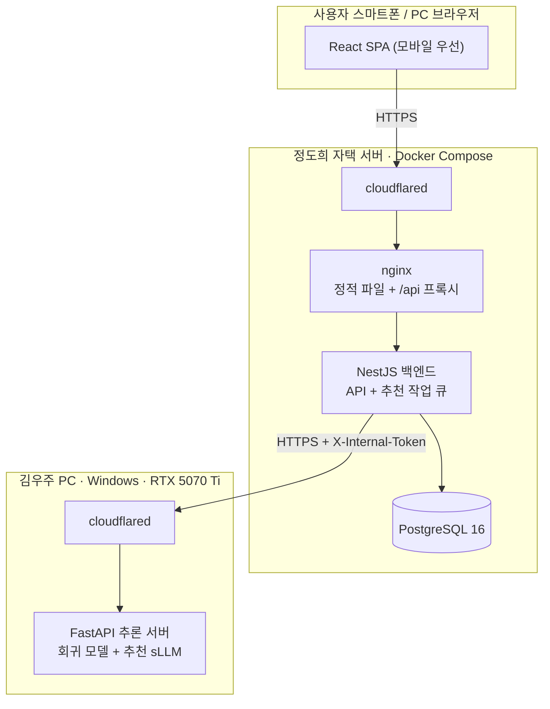
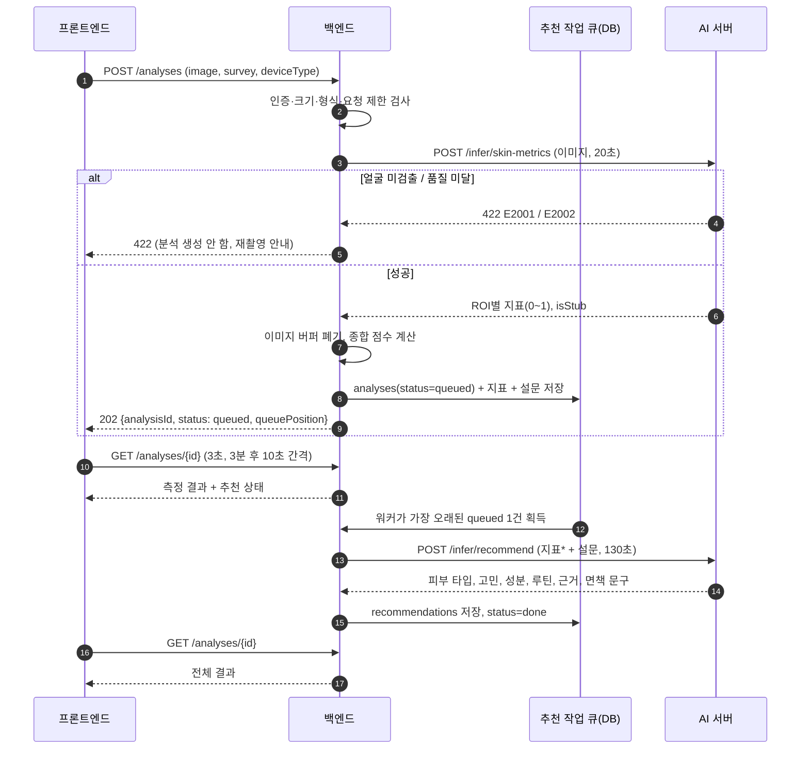
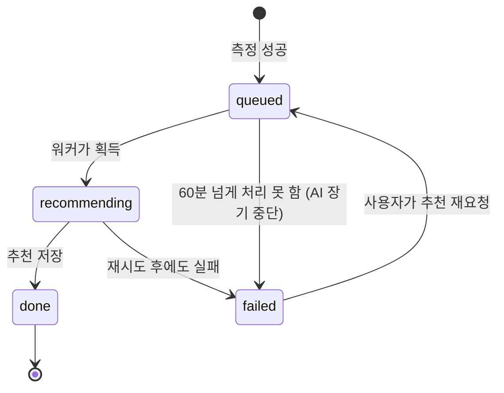
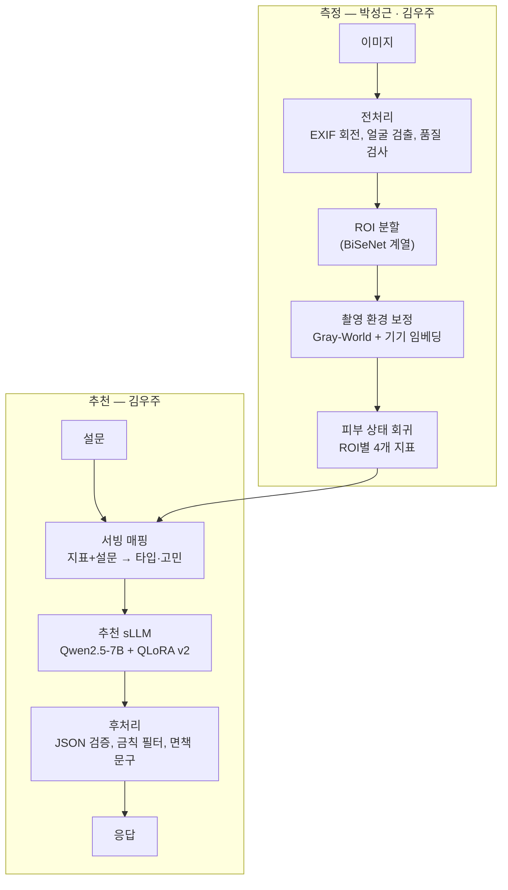

# 시스템 설계서

**문서 번호** SC-02 · **버전** v1.0 (2026-10-01) · **작성** 김우주 · **관리** 손승우

## 1. 설계 원칙

1. **클라이언트는 AI 서버를 모른다.** 모든 요청은 백엔드를 거친다. AI 서버 주소·토큰은 백엔드 환경변수에만 있다.
2. **측정은 빠르게, 추천은 줄 세워서.** 측정(약 3초)은 요청 안에서 끝내고, 추천(약 50초)은 백엔드 작업 큐가 GPU에 한 건씩 넣는다.
3. **얼굴 이미지는 디스크에 닿지 않는다.** 백엔드는 업로드를 메모리 버퍼로만 받아 AI 서버로 넘기고, 측정이 끝나면 버린다. 추천 단계에는 이미지가 필요 없다.
4. **AI 서버가 꺼져도 서비스는 산다.** AI 서버는 조장 PC에서만 돌기 때문에, 꺼져 있으면 분석만 막고 나머지 기능은 정상 동작한다.
5. **AI 출력은 그대로 믿지 않는다.** 금칙 표현 필터와 면책 문구는 AI 서버에서, 열거형 검증과 0–100 변환은 백엔드에서 한 번 더 한다.

## 2. 전체 구성



| 구성요소 | 기술 | 담당 | 책임 |
|---|---|---|---|
| 프론트엔드 | React 18, TypeScript, Vite, React Router, TanStack Query | 정도희 | 촬영·업로드, 설문, 결과·이력 화면, 상태 폴링 |
| 웹 서버 | nginx | 정도희 | 빌드 결과 서빙, `/api` → 백엔드 프록시, 업로드 크기 제한(12MB) |
| 백엔드 | NestJS 10, TypeORM, class-validator, Swagger | 이현승 | 인증, 분석 API, 추천 작업 큐, AI 서버 호출, 결과 저장 |
| DB | PostgreSQL 16 | 이현승 | 사용자, 분석, 지표, 설문, 추천 저장 ([DB 설계서](04-database.md)) |
| AI 추론 서버 | FastAPI, PyTorch, transformers, PEFT | 김우주 | 측정, 피부 타입·고민 도출, 추천 생성, 금칙 표현 필터 |
| 터널 | Cloudflare Tunnel | 정도희, 김우주 | 포트포워딩 없이 HTTPS 외부 노출 |

## 3. 분석 처리 흐름

### 3.1 시퀀스



\* 측정값이 데모 값(`is_demo`)이면 `metrics: null`로 보내, 가짜 값이 피부 타입·고민 추정에 섞이지 않게 합니다. 이 경우 추천은 설문만으로 만들어집니다.

### 3.2 왜 측정과 추천을 나눴나

| 대안 | 문제 |
|---|---|
| `/infer/analyze` 한 번 호출 | 사용자가 50초 이상 아무 결과도 못 봄. 대기 중 이미지를 백엔드가 계속 들고 있어야 함 |
| 측정·추천 모두 큐 | 측정 대기 중 이미지를 임시 저장해야 함 → 개인정보 원칙 3 위반 |
| **측정은 요청 안에서, 추천만 큐 (채택)** | 측정 3초 만에 결과 화면 진입, 이미지는 요청이 끝나면 사라짐, GPU 생성은 순서대로 |

### 3.3 분석 상태 전이



측정 단계에서 실패하면 분석 행 자체를 만들지 않으므로 상태가 없습니다.

## 4. 백엔드 설계 (`skincare-backend`)

### 4.1 모듈

| 모듈 | 책임 | 주요 클래스 |
|---|---|---|
| `auth` | 가입, 로그인, 토큰 재발급·폐기 | `AuthController`, `AuthService`, `JwtStrategy` |
| `users` | 내 정보 조회, 탈퇴 | `UsersController`, `UsersService` |
| `analyses` | 분석 생성·조회·목록·추이·삭제 | `AnalysesController`, `AnalysesService` |
| `recommendation` | 추천 작업 큐 워커 | `RecommendationWorker` |
| `ai-client` | AI 서버 호출. `AI_MODE=real`이면 HTTP, `fixture`면 고정 응답 | `AiClient`(인터페이스), `HttpAiClient`, `FixtureAiClient` |
| `system` | 서비스 상태(AI 가용성, 대기열 길이) | `SystemController` |
| `common` | 응답 포맷, 에러 필터, 요청 ID, 로깅 | `ApiExceptionFilter`, `RequestIdMiddleware` |

`FixtureAiClient`는 `skincare-ai`의 실제 응답 예시(JSON)를 그대로 돌려줍니다. 백엔드·프론트 개발은 AI 서버가 꺼져 있어도 이 모드로 진행합니다.

### 4.2 추천 작업 큐

별도 큐 인프라(Redis 등) 없이 **PostgreSQL을 큐로** 씁니다. 백엔드 인스턴스는 1개입니다.

| 항목 | 설계 |
|---|---|
| 작업 획득 | 1초마다 `SELECT … FROM analyses WHERE status='queued' ORDER BY queued_at LIMIT 1 FOR UPDATE SKIP LOCKED` → `recommending`으로 변경 |
| 동시성 | 1 (`REC_WORKER_CONCURRENCY=1`). GPU 생성이 직렬이기 때문 |
| 호출 타임아웃 | 130초 (`AI_REC_TIMEOUT_MS`). AI 서버 내부 타임아웃(120초)보다 길게 둬서 보통은 AI의 504를 먼저 받음 |
| 재시도 | **연결 오류와 503(E3003)만** 1회, 5초 후. **504(E3002)와 422는 재시도하지 않음** — AI 서버는 타임아웃이 나도 진행 중인 생성을 끝까지 돌리며 GPU를 붙잡고 있어, 곧바로 재시도하면 그 뒤에 줄을 서다 다시 타임아웃이 나고 다음 작업까지 밀린다 |
| AI 서버 비가용 | `aiAvailable=false`인 동안 작업 획득을 멈춤(대기열 유지). 복구되면 이어서 처리 |
| 장기 대기 | `queued` 60분 초과 시 `failed`, `error_code=E3001` (AI 서버가 오래 꺼져 있던 경우) |
| 서버 재시작 복구 | 기동 시 `recommending` 상태를 모두 `queued`로 되돌림 (`queued_at`은 유지해 순서 보존) |
| 대기열 상한 | `queued` 건수가 `REC_QUEUE_LIMIT`(10) 이상이면 새 분석 거부 (E3003). 10건 × 약 55초 ≈ 10분이 사용자가 기다릴 수 있는 한계로 봄 |
| 데모 측정값 | `is_demo=true` 분석은 추천 요청의 `metrics`를 `null`로 보냄 |
| 대기 순번 | 내 `queued_at`보다 앞선 `queued` 건수 + 1 |
| 예상 대기 | 대기 순번 × 최근 완료 20건의 평균 추천 소요 시간 (없으면 55초) |

### 4.3 AI 서버 에러 변환

AI 서버의 에러를 그대로 내보내지 않고 백엔드 코드로 바꿉니다. 특히 AI의 401을 그대로 전달하면 프론트가 "사용자 토큰 만료"로 오해해 로그아웃시킵니다.

| AI 서버 응답 | 측정(`POST /analyses` 안) | 추천(워커) |
|---|---|---|
| 401 E1001 (내부 토큰 불일치) | 503 E3001 + ERROR 로그 | `failed` E3001 + ERROR 로그 |
| 413 E2003 / 415 E2004 | 그대로 | — |
| 422 E2001 / E2002 | 그대로 (재촬영 안내) | — |
| 422 E4002 | 500 E4001 + ERROR 로그 (백엔드 변환 버그) | `failed` E4001 |
| 503 E3003 | 그대로 | 1회 재시도 후 `failed` E3003 |
| 504 E3002 | 그대로 | 재시도 없이 `failed` E3002 |
| 연결 실패·응답 없음 | 503 E3001 | 1회 재시도 후 `failed` E3001 |

### 4.4 이미지 처리

- `multer` **memoryStorage**로 받고 디스크 저장 옵션을 쓰지 않는다.
- 형식 판별은 확장자가 아니라 파일 시그니처(JPEG `FF D8 FF`, PNG `89 50 4E 47`)로 한다.
- AI 서버 응답을 받은 즉시 버퍼 참조를 해제한다. 로그·에러 메시지에 이미지 내용을 넣지 않는다.

### 4.5 종합 점수와 등급

AI 서버는 0–1 값을 주고, 백엔드는 그 값을 그대로 저장했다가 응답할 때 0–100 정수로 바꿉니다. 색소침착·모공은 높을수록 나쁜 지표라 점수 계산 시 뒤집습니다.

```
value(m)     = round(원본 × 100)                       # 표시용 정수
score(m)     = moisture, elasticity  → value
               pigmentation, pore    → 100 − value
grade(score) = good(≥70) / normal(40–69) / care(<40)  # 정수 score 기준
overallScore = round( 평균( 원본 기반 score 4개, 반올림 전 값 ) )
ROI 점수     = 같은 식을 각 ROI에 적용 (byRoi[].overallScore, grade)
```

- `round`는 0.5 올림(JavaScript `Math.round`)입니다.
- 종합 점수는 `full_face` 기준입니다. `full_face`가 없으면 검출된 ROI 평균으로 계산합니다(AI 서버 어댑터와 같은 규칙).
- 등급은 백엔드가 계산해 내려주고, 프론트는 표시만 합니다(규칙 중복 방지).

## 5. 프론트엔드 설계 (`skincare-frontend`)

| 항목 | 설계 |
|---|---|
| 라우팅 | React Router. 경로는 [화면 설계서 §2](05-screen-design.md#2-화면-목록) |
| 서버 상태 | TanStack Query. 분석 상세는 `status`가 `queued`·`recommending`일 때만 refetch — 처음 3분은 3초, 이후 10초 간격, 15분이 지나면 중단 |
| HTTP | axios 인스턴스 1개, `withCredentials: true`. 401(E1001) 응답 시 `/auth/refresh` 후 원 요청 재시도. **동시에 여러 요청이 401을 받아도 refresh는 한 번만 보내고(single-flight) 나머지는 그 결과를 기다림** — 리프레시 토큰을 교체 방식으로 쓰기 때문에 두 번 보내면 재사용으로 판정돼 로그아웃됨 |
| 토큰 | 액세스 토큰은 메모리(상태)에만, 리프레시 토큰은 httpOnly 쿠키. **앱 시작 시 라우트 가드보다 먼저 `/auth/refresh`를 호출**해 로그인 상태를 복원 |
| 로컬 개발 | Vite dev server proxy로 `/api` → `localhost:3000`. 같은 출처가 되어 쿠키·CORS 문제가 없음 |
| 타입 | 백엔드 Swagger(`/api/docs-json`)에서 `openapi-typescript`로 타입 생성 |
| 이미지 | 업로드 전 캔버스로 긴 변 1600px 리사이즈, JPEG 품질 0.9 (용량·전송 시간 절감) |

## 6. AI 서버 설계 (`skincare-ai`)

### 6.1 내부 파이프라인



| 단계 | 현재 상태 (10/1) | 담당 | 코드 위치 |
|---|---|---|---|
| 전처리·ROI·회귀·보정 | 미연결 — stub이 데모 값 반환 | 박성근, 김우주 | `server/skin_regressor.py`의 `SkinRegressor` 규약에 맞춰 연결 |
| 서빙 매핑 | 완료 (임계값 `[확인필요]`) | 김우주 | `configs/serving_mapping.yaml` |
| 추천 sLLM | 완료 — v2 어댑터 | 김우주 | `src/llm/`, `outputs/rec_sllm_v2/adapter` |
| 금칙 필터 | 완료 | 김우주, 손승우(규칙) | `configs/filter_rules.yaml` |

### 6.2 동시성

| 작업 | 동시 처리 | 대기열 | 타임아웃(서버 내부) |
|---|---|---|---|
| 측정 | 4 | 20 | 30초 |
| 추천 | 1 | 20 | 120초 (`REC_TIMEOUT_S`) |

VRAM 사용량은 추천 sLLM(4-bit) 약 6GB + 생성 캐시, 회귀 모델 1GB 미만으로 16GB 안에 함께 올라갑니다. 학습 중에는 서버를 내려야 합니다.

### 6.3 폴백과 안전장치

- sLLM 출력이 JSON 형식을 어기면 1회 재생성, 다시 실패하면 규칙 기반 추천을 내보내고 `used_fallback: true`로 표시합니다.
- 금칙 필터가 문장을 지우거나 바꾸면 `filtered: true`. v2 기준 201건 중 1건(0.5%)에서만 개입했습니다.
- 응답 범위: `ingredients` 최대 5개(`purpose`는 `null` 가능). 2026-10-21부터 성분·실행 가능한 루틴 등이 남지 않는 추천은 품질 보류로 처리합니다. 질환 통합 경로는 `recommendation_status: quality_rejected`, `recommendation: null`을 반환합니다. 후처리로 추론 문단이 제거될 수 있으므로 문단 수를 고정하지 않습니다. 백엔드·프론트 상태 분기와 추가 필드는 [추천 품질 계약](../recommendation-quality.md)을 따릅니다.
- 추천 모델은 **측정값 숫자나 부위를 직접 보지 않습니다.** 측정값은 서빙 매핑을 거쳐 피부 타입·고민으로만 전달되므로, 추천 이유에 "이마 수분 61" 같은 수치는 나오지 않습니다.

## 7. 배포 구성

### 7.1 웹 서비스 (정도희 자택 서버)

```
docker-compose.yml
├─ web        nginx:1.27-alpine   (프론트 빌드 결과 + /api 프록시)
├─ backend    node:20-alpine      (NestJS, 포트 3000 — 외부 비공개)
├─ db         postgres:16-alpine  (볼륨 pgdata, 외부 비공개)
└─ cloudflared                    (app.<도메인> → web:80)
```

- 외부에 여는 포트는 없습니다. Cloudflare Tunnel이 HTTPS를 처리합니다.
- DB는 매일 03:00 `pg_dump`로 백업하고 7일치를 보관합니다.
- 배포: `main` 병합 → 서버에서 `git pull && docker compose up -d --build` (자동화는 S 우선순위).

### 7.2 AI 서버 (김우주 PC)

```powershell
# 레포 루트에서
$env:REC_BACKEND="sllm"; .\scripts\run_server.ps1     # uvicorn :8000
cloudflared tunnel run skincare-ai                     # ai.<도메인> → localhost:8000
```

- 도메인이 없으면(결정 D3) `cloudflared tunnel --url http://localhost:8000`의 임시 주소를 쓰되, **재시작할 때마다 백엔드의 `AI_BASE_URL`을 바꿔야** 합니다.
- 학습·평가를 돌리는 동안에는 추론 서버를 내리고 `GET /system/status`가 `aiAvailable: false`를 보여주게 둡니다.

## 8. 보안 · 개인정보 설계

| 위협 / 요구 | 대책 | 위치 |
|---|---|---|
| 비밀번호 유출 | bcrypt cost 12, 로그인 실패 메시지를 이메일·비밀번호 구분 없이 동일하게 | 백엔드 |
| 토큰 탈취 | 액세스 1시간, 리프레시 14일 httpOnly·Secure·SameSite=Strict 쿠키, 리프레시는 DB에 해시로 저장하고 사용 시 교체 | 백엔드 |
| 타인 분석 열람(IDOR) | 모든 분석 조회에 `user_id` 조건. 없거나 남의 것이면 동일하게 404 | 백엔드 |
| 무차별 요청 | 로그인 IP당 분당 10회, 분석 사용자당 일 20건. 터널·nginx 뒤라 모든 요청의 출발 IP가 같으므로 **`CF-Connecting-IP` 헤더로 실제 IP를 판별**(nginx `real_ip_header`, Express `trust proxy`) | 백엔드, nginx |
| AI 서버 직접 호출 | 내부 토큰(HMAC 비교, 미설정 시 전부 거부) | AI 서버 |
| 이미지 잔존 | 메모리 버퍼만 사용, 디스크 저장 경로 없음 | 백엔드, AI 서버 |
| 로그 유출 | 이미지·설문 원문·토큰 비기록. 이메일은 마스킹(`d***@gmail.com`) | 전 구간 |
| 비밀값 노출 | `.env`는 `.gitignore`, `.env.example`만 커밋. GitHub secret scanning 활성화 | 전 레포 |
| 학습 데이터 재배포 | `data/`, `outputs/` git 제외 | AI 레포 |
| 과도한 의료 표현 | 금칙 필터 + 면책 문구 + 화면 문구 규칙([화면 설계서 §4](05-screen-design.md#4-문구-규칙)) | AI 서버, 프론트 |

## 9. 장애 대응

| 상황 | 감지 | 사용자에게 보이는 것 | 시스템 동작 |
|---|---|---|---|
| AI 서버 꺼짐 | 백엔드가 30초마다 `/health` 확인 | 홈·촬영 화면 "분석 서버 점검 중", 제출 버튼 비활성. 대기 중인 분석은 "서버가 돌아오면 이어서 작성돼요" | 새 분석 거부(E3001), 워커 일시 정지, 대기열 유지 |
| 추천 타임아웃 | AI 504 E3002 | 측정 결과 + "추천을 만들지 못했어요. 다시 시도" | 재시도 없이 `failed` |
| 백엔드 재시작 | — | 진행 중이던 추천이 잠시 멈춘 뒤 재개 | `recommending` → `queued` 복구 |
| 대기열 가득 | `queued` ≥ 10 | "지금 요청이 많아요. 잠시 후 다시 시도해 주세요" | 503 E3003 |
| DB 장애 | 헬스체크 실패 | 공통 오류 화면 | 500 E4001 |

## 10. 로깅 · 측정

- 모든 요청에 `X-Request-Id`(없으면 백엔드가 UUID 생성)를 붙이고, 백엔드→AI 서버 호출에도 그대로 전달합니다.
- `analyses` 테이블에 `measure_ms`, `recommend_ms`, `queue_wait_ms`를 저장합니다. 최종 성능 분석(응답 시간 분포, 대기 시간)은 이 값으로 계산합니다.
- AI 서버는 필터 개입·폴백 발생을 INFO 로그로 남깁니다.
