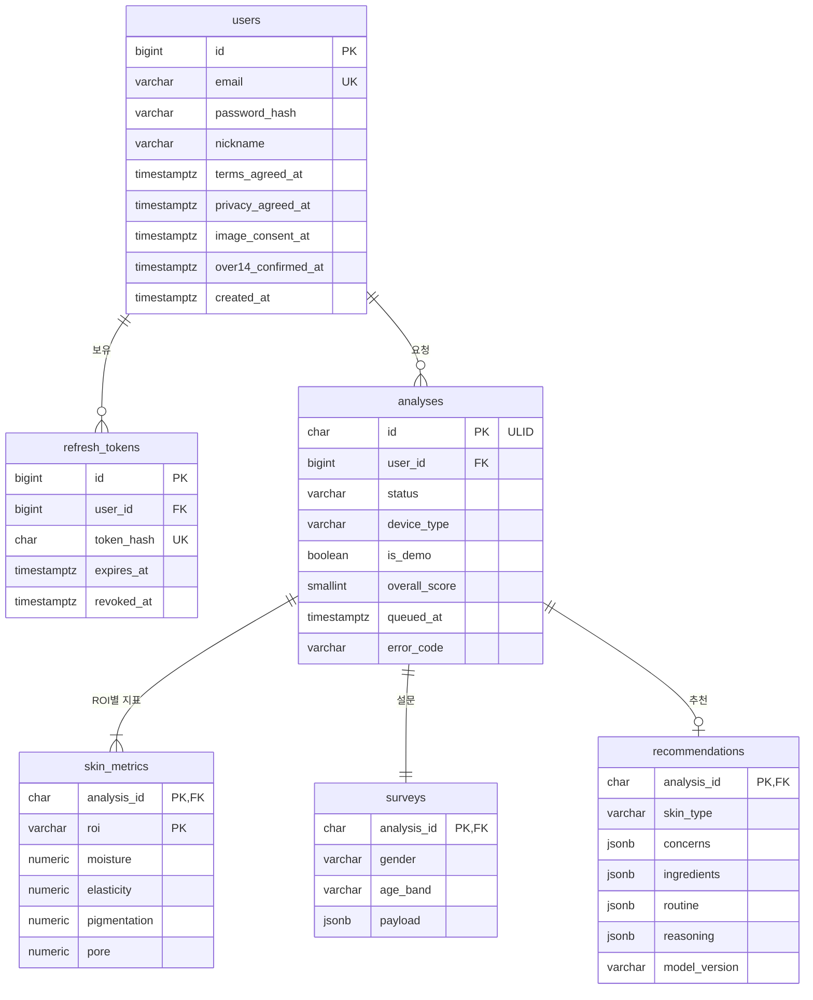

# DB 설계서

**문서 번호** SC-04 · **버전** v1.0 (2026-10-01) · **작성** 김우주 · **구현** 이현승

PostgreSQL 16, 스키마 `public`, 문자 인코딩 UTF-8, 시간대 UTC.

## 1. ERD



## 2. 테이블 정의

### 2.1 users — 회원

| 컬럼 | 타입 | NULL | 기본값 | 설명 |
|---|---|---|---|---|
| id | BIGSERIAL | N | | PK |
| email | VARCHAR(255) | N | | 소문자 정규화, UNIQUE |
| password_hash | VARCHAR(100) | N | | bcrypt (cost 12) |
| nickname | VARCHAR(20) | N | | |
| terms_agreed_at | TIMESTAMPTZ | N | | 이용약관 동의 시각 |
| privacy_agreed_at | TIMESTAMPTZ | N | | 개인정보 수집·이용 동의 시각 |
| image_consent_at | TIMESTAMPTZ | N | | 얼굴 이미지 처리 동의 시각 |
| over14_confirmed_at | TIMESTAMPTZ | N | | 만 14세 이상 확인 시각 |
| created_at | TIMESTAMPTZ | N | now() | |
| updated_at | TIMESTAMPTZ | N | now() | |

### 2.2 refresh_tokens — 리프레시 토큰

| 컬럼 | 타입 | NULL | 기본값 | 설명 |
|---|---|---|---|---|
| id | BIGSERIAL | N | | PK |
| user_id | BIGINT | N | | FK users, ON DELETE CASCADE |
| token_hash | CHAR(64) | N | | SHA-256(토큰). 원문 저장 금지. UNIQUE |
| expires_at | TIMESTAMPTZ | N | | 발급 + 14일 |
| revoked_at | TIMESTAMPTZ | Y | | 로그아웃·교체 시각 |
| replaced_by | BIGINT | Y | | 교체한 새 토큰 id (재사용 감지용) |
| created_at | TIMESTAMPTZ | N | now() | |

### 2.3 analyses — 분석

| 컬럼 | 타입 | NULL | 기본값 | 설명 |
|---|---|---|---|---|
| id | CHAR(26) | N | | ULID. URL에 노출 |
| user_id | BIGINT | N | | FK users, ON DELETE CASCADE |
| status | VARCHAR(16) | N | 'queued' | `queued` · `recommending` · `done` · `failed` |
| device_type | VARCHAR(16) | N | | `smartphone` · `tablet` · `camera` |
| is_demo | BOOLEAN | N | | AI `is_stub` 그대로. true면 데모 측정값 |
| confidence | NUMERIC(4,3) | N | | 측정 신뢰도 0–1 |
| calibration_applied | BOOLEAN | N | false | 촬영 환경 보정 적용 여부 |
| overall_score | SMALLINT | N | | 0–100 ([시스템 설계서 §4.5](02-system-design.md#45-종합-점수와-등급)) |
| skin_model_version | VARCHAR(40) | N | | 예: `skin_reg_v1` |
| measure_ms | INTEGER | N | | 측정 API 왕복 시간 |
| queued_at | TIMESTAMPTZ | N | now() | 큐 진입 (재요청 시 갱신) |
| rec_started_at | TIMESTAMPTZ | Y | | 워커 획득 시각 |
| completed_at | TIMESTAMPTZ | Y | | `done`·`failed` 확정 시각 |
| queue_wait_ms | INTEGER | Y | | rec_started_at − queued_at |
| recommend_ms | INTEGER | Y | | 추천 API 왕복 시간 |
| attempt_count | SMALLINT | N | 0 | 추천 호출 횟수 (재시도 포함) |
| error_code | VARCHAR(10) | Y | | 실패 시 에러 코드 |
| created_at | TIMESTAMPTZ | N | now() | |

### 2.4 skin_metrics — ROI별 지표

| 컬럼 | 타입 | NULL | 설명 |
|---|---|---|---|
| analysis_id | CHAR(26) | N | PK, FK analyses, ON DELETE CASCADE |
| roi | VARCHAR(16) | N | PK. [API §6.2](03-api-spec.md#62-roi-roi) |
| moisture | NUMERIC(5,4) | N | 0–1 원본 |
| elasticity | NUMERIC(5,4) | N | 0–1 원본 |
| pigmentation | NUMERIC(5,4) | N | 0–1 원본 (높을수록 나쁨) |
| pore | NUMERIC(5,4) | N | 0–1 원본 (높을수록 나쁨) |

0–1 원본을 저장하는 이유: 추천 API에 그대로 다시 넘기고, 최종 성능 분석에서 반올림 손실 없이 쓰기 위해서입니다. 0–100 변환은 응답 시점에 합니다.

> TypeORM은 `NUMERIC` 컬럼을 **문자열**로 돌려줍니다. 점수 계산이 문자열 연결로 깨지지 않도록 엔티티에 `transformer: { to: (v) => v, from: (v) => (v === null ? null : Number(v)) }`를 지정합니다(`confidence` 포함).

### 2.5 surveys — 설문

| 컬럼 | 타입 | NULL | 설명 |
|---|---|---|---|
| analysis_id | CHAR(26) | N | PK, FK analyses, ON DELETE CASCADE |
| gender | VARCHAR(8) | N | 통계·필터용으로 분리 |
| age_band | VARCHAR(4) | N | 〃 |
| skin_type | VARCHAR(16) | Y | 사용자 자가응답 코드 |
| payload | JSONB | N | 제출한 설문 전체 ([API §4.1](03-api-spec.md#41-post-analyses)) |

### 2.6 recommendations — 추천

| 컬럼 | 타입 | NULL | 설명 |
|---|---|---|---|
| analysis_id | CHAR(26) | N | PK, FK analyses, ON DELETE CASCADE |
| skin_type | VARCHAR(16) | N | 도출된 피부 타입 **코드** |
| concerns | JSONB | N | 고민 코드 배열 `["pore","pigmentation"]` |
| ingredients | JSONB | N | `[{name, purpose, priority}]` |
| routine | JSONB | N | `[{step, time, action}]` |
| reasoning | JSONB | N | 문자열 배열 |
| answer | TEXT | N | 요약 문단 |
| disclaimer | TEXT | N | 면책 문구 |
| input_notes | JSONB | N | 추정 입력 내역 |
| filtered | BOOLEAN | N | 금칙 필터 개입 여부 |
| used_fallback | BOOLEAN | N | 규칙 기반 폴백 여부 |
| model_version | VARCHAR(40) | N | 예: `rec_sllm_v2` |
| inference_ms | INTEGER | N | AI 서버 내부 생성 시간 |
| created_at | TIMESTAMPTZ | N | now() |

## 3. DDL

```sql
CREATE TABLE users (
  id                  BIGSERIAL PRIMARY KEY,
  email               VARCHAR(255) NOT NULL UNIQUE,
  password_hash       VARCHAR(100) NOT NULL,
  nickname            VARCHAR(20)  NOT NULL,
  terms_agreed_at     TIMESTAMPTZ  NOT NULL,
  privacy_agreed_at   TIMESTAMPTZ  NOT NULL,
  image_consent_at    TIMESTAMPTZ  NOT NULL,
  over14_confirmed_at TIMESTAMPTZ  NOT NULL,
  created_at          TIMESTAMPTZ  NOT NULL DEFAULT now(),
  updated_at          TIMESTAMPTZ  NOT NULL DEFAULT now()
);

CREATE TABLE refresh_tokens (
  id          BIGSERIAL PRIMARY KEY,
  user_id     BIGINT      NOT NULL REFERENCES users(id) ON DELETE CASCADE,
  token_hash  CHAR(64)    NOT NULL UNIQUE,
  expires_at  TIMESTAMPTZ NOT NULL,
  revoked_at  TIMESTAMPTZ,
  replaced_by BIGINT,
  created_at  TIMESTAMPTZ NOT NULL DEFAULT now()
);
CREATE INDEX idx_refresh_tokens_user ON refresh_tokens(user_id);

CREATE TABLE analyses (
  id                  CHAR(26)     PRIMARY KEY,
  user_id             BIGINT       NOT NULL REFERENCES users(id) ON DELETE CASCADE,
  status              VARCHAR(16)  NOT NULL DEFAULT 'queued'
                      CHECK (status IN ('queued','recommending','done','failed')),
  device_type         VARCHAR(16)  NOT NULL
                      CHECK (device_type IN ('smartphone','tablet','camera')),
  is_demo             BOOLEAN      NOT NULL,
  confidence          NUMERIC(4,3) NOT NULL CHECK (confidence BETWEEN 0 AND 1),
  calibration_applied BOOLEAN      NOT NULL DEFAULT false,
  overall_score       SMALLINT     NOT NULL CHECK (overall_score BETWEEN 0 AND 100),
  skin_model_version  VARCHAR(40)  NOT NULL,
  measure_ms          INTEGER      NOT NULL,
  queued_at           TIMESTAMPTZ  NOT NULL DEFAULT now(),
  rec_started_at      TIMESTAMPTZ,
  completed_at        TIMESTAMPTZ,
  queue_wait_ms       INTEGER,
  recommend_ms        INTEGER,
  attempt_count       SMALLINT     NOT NULL DEFAULT 0,
  error_code          VARCHAR(10),
  created_at          TIMESTAMPTZ  NOT NULL DEFAULT now()
);
CREATE INDEX idx_analyses_user_created ON analyses(user_id, created_at DESC);
CREATE INDEX idx_analyses_queue ON analyses(queued_at) WHERE status = 'queued';

CREATE TABLE skin_metrics (
  analysis_id  CHAR(26)     NOT NULL REFERENCES analyses(id) ON DELETE CASCADE,
  roi          VARCHAR(16)  NOT NULL,
  moisture     NUMERIC(5,4) NOT NULL CHECK (moisture     BETWEEN 0 AND 1),
  elasticity   NUMERIC(5,4) NOT NULL CHECK (elasticity   BETWEEN 0 AND 1),
  pigmentation NUMERIC(5,4) NOT NULL CHECK (pigmentation BETWEEN 0 AND 1),
  pore         NUMERIC(5,4) NOT NULL CHECK (pore         BETWEEN 0 AND 1),
  PRIMARY KEY (analysis_id, roi)
);

CREATE TABLE surveys (
  analysis_id CHAR(26)    PRIMARY KEY REFERENCES analyses(id) ON DELETE CASCADE,
  gender      VARCHAR(8)  NOT NULL,
  age_band    VARCHAR(4)  NOT NULL,
  skin_type   VARCHAR(16),
  payload     JSONB       NOT NULL
);

CREATE TABLE recommendations (
  analysis_id   CHAR(26)    PRIMARY KEY REFERENCES analyses(id) ON DELETE CASCADE,
  skin_type     VARCHAR(16) NOT NULL,
  concerns      JSONB       NOT NULL,
  ingredients   JSONB       NOT NULL,
  routine       JSONB       NOT NULL,
  reasoning     JSONB       NOT NULL,
  answer        TEXT        NOT NULL,
  disclaimer    TEXT        NOT NULL,
  input_notes   JSONB       NOT NULL DEFAULT '[]',
  filtered      BOOLEAN     NOT NULL,
  used_fallback BOOLEAN     NOT NULL,
  model_version VARCHAR(40) NOT NULL,
  inference_ms  INTEGER     NOT NULL,
  created_at    TIMESTAMPTZ NOT NULL DEFAULT now()
);
```

## 4. 주요 쿼리

**추천 작업 획득** (워커, 1초마다)
```sql
UPDATE analyses SET status = 'recommending', rec_started_at = now(),
       queue_wait_ms = (EXTRACT(EPOCH FROM now() - queued_at) * 1000)::int,
       attempt_count = attempt_count + 1
 WHERE id = (SELECT id FROM analyses WHERE status = 'queued'
              ORDER BY queued_at LIMIT 1 FOR UPDATE SKIP LOCKED)
RETURNING id;
```

**대기 순번**
```sql
SELECT COUNT(*) + 1 FROM analyses
 WHERE status = 'queued' AND queued_at < (SELECT queued_at FROM analyses WHERE id = $1);
```

**평균 추천 시간** (예상 대기 계산)
```sql
SELECT COALESCE(AVG(recommend_ms), 55000) FROM
  (SELECT recommend_ms FROM analyses WHERE status = 'done' AND recommend_ms IS NOT NULL
    ORDER BY completed_at DESC LIMIT 20) t;
```

**서버 기동 시 복구**
```sql
UPDATE analyses SET status = 'queued' WHERE status = 'recommending';
```

**장기 대기 처리** (1분마다)
```sql
UPDATE analyses SET status = 'failed', error_code = 'E3001', completed_at = now()
 WHERE status = 'queued' AND queued_at < now() - interval '60 minutes';
```

**대기열 상한 확인** (분석 생성 전)
```sql
SELECT COUNT(*) FROM analyses WHERE status = 'queued';   -- REC_QUEUE_LIMIT(10) 이상이면 E3003
```

AI 서버가 비가용(`aiAvailable=false`)인 동안 워커는 작업 획득 쿼리를 실행하지 않습니다.

## 5. 데이터 보존 · 삭제

| 데이터 | 저장 위치 | 보존 | 삭제 |
|---|---|---|---|
| 얼굴 원본 이미지 | **저장하지 않음** (요청 중 메모리) | — | 측정 응답 직후 |
| 계정 | users | 탈퇴 시까지 | 탈퇴 즉시 (CASCADE로 하위 전부) |
| 분석·지표·설문·추천 | analyses 외 4개 | 사용자가 삭제하거나 탈퇴할 때까지 | 즉시 |
| 리프레시 토큰 | refresh_tokens | 만료 후 7일 | 매일 03:30 배치 |
| DB 백업 | 서버 로컬 디스크 | 7일 | 순환 삭제 |
| 애플리케이션 로그 | 컨테이너 로그 | 14일 | Docker 로그 로테이션 |

탈퇴한 사용자의 데이터는 백업에 최대 7일 남을 수 있습니다. 개인정보 처리방침에 이 사실을 적습니다(담당 손승우).

## 6. 마이그레이션 규칙

- TypeORM 마이그레이션만 사용합니다. 운영 DB에서 `synchronize: true` 금지.
- 파일 이름: `{타임스탬프}-{동사}{대상}.ts` (예: `1727740800000-CreateAnalyses.ts`).
- 스키마를 바꾸는 PR에는 마이그레이션 파일과 이 문서 수정이 함께 들어가야 합니다.
- 개발·테스트용 시드(`npm run seed`): `test01`~`test40@skincare.dev` 계정(동시 요청 테스트용), 그중 `test01`에 완료된 분석 25건(이력 페이지·추이 확인용, 날짜 분산). 운영에서는 실행하지 않습니다.
