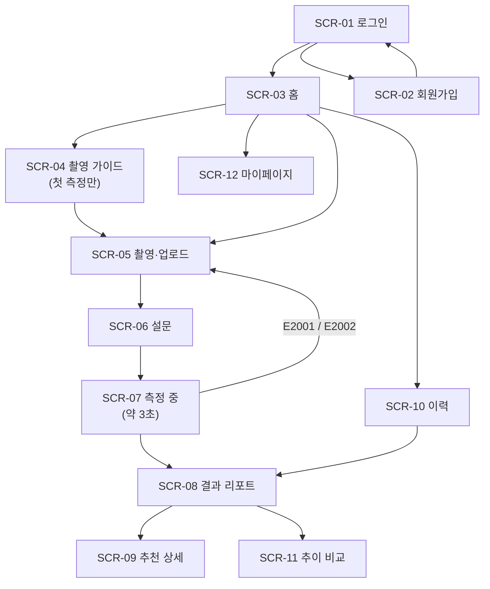
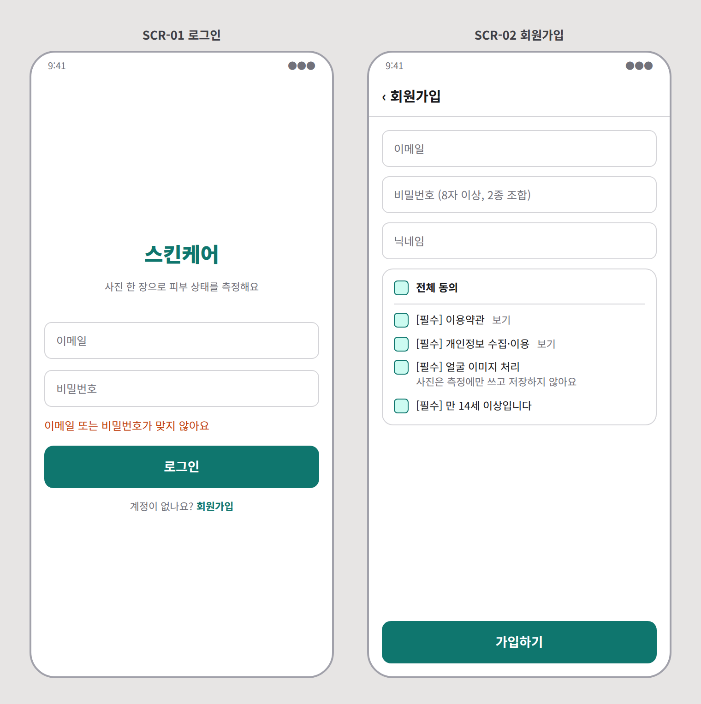
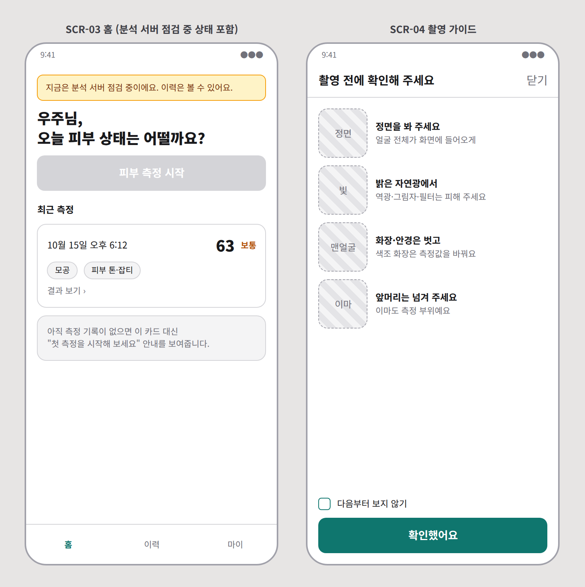
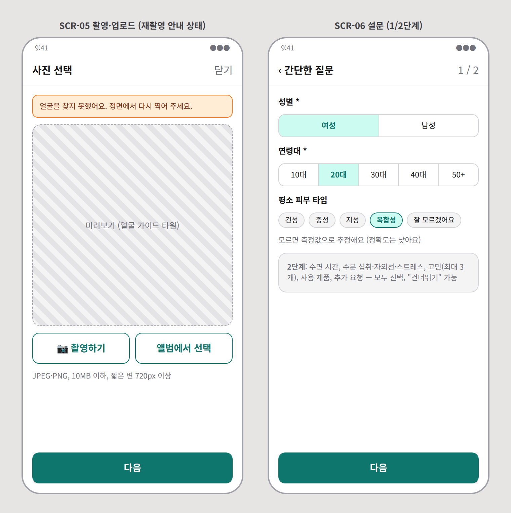
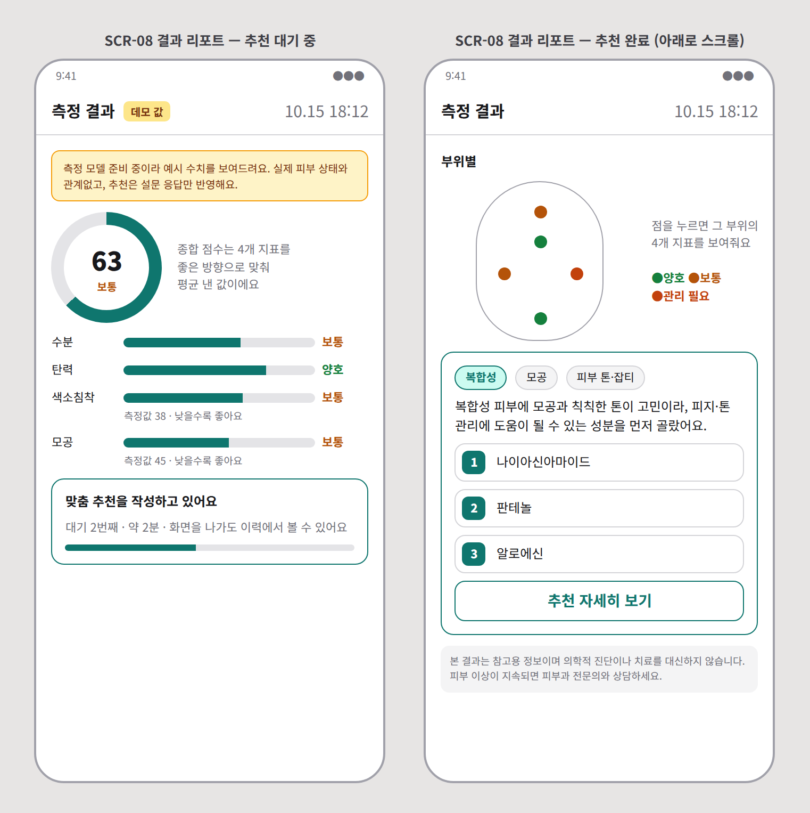
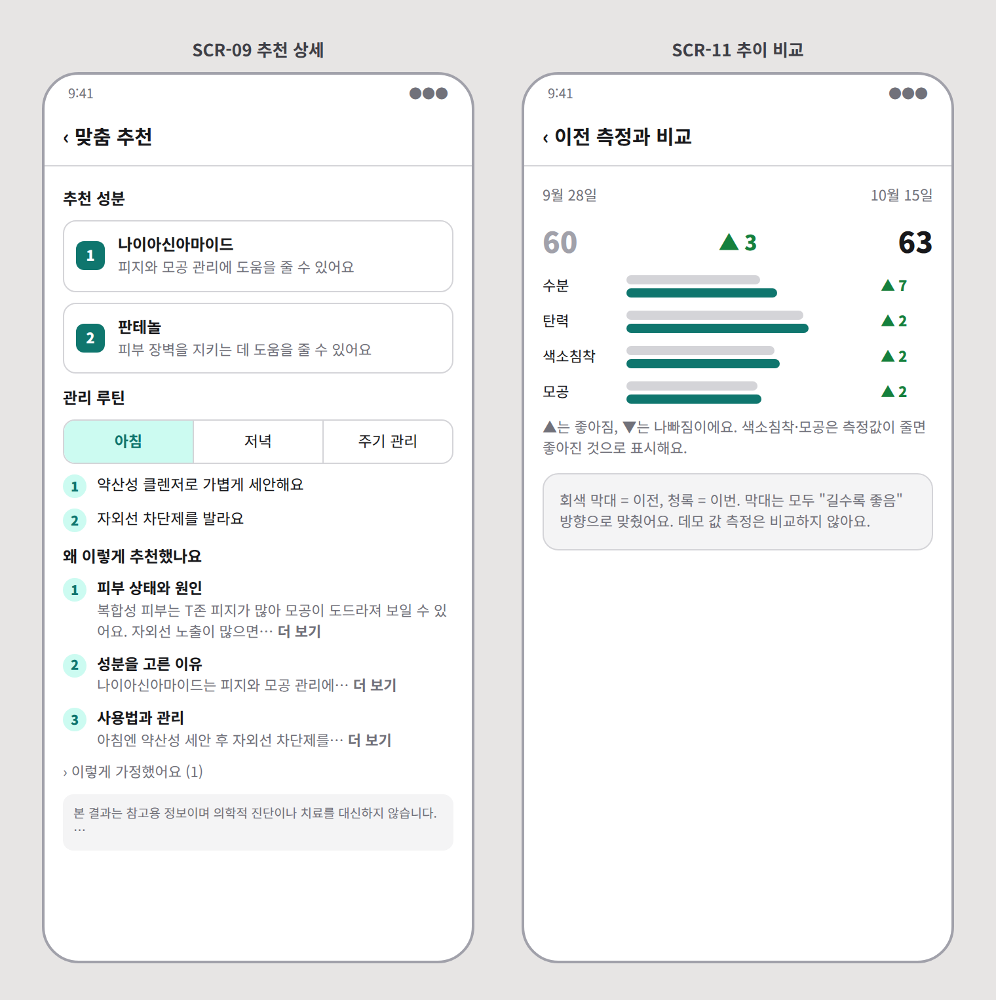
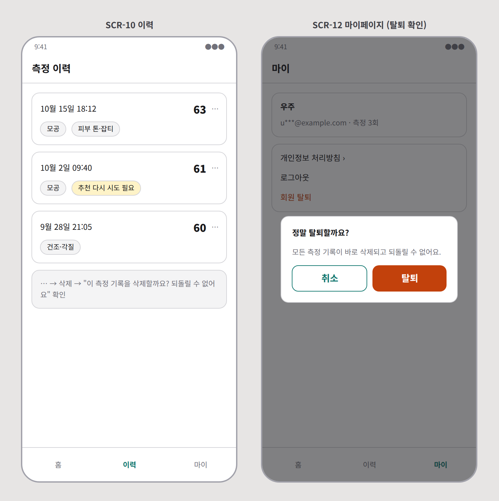

# 화면 설계서

**문서 번호** SC-05 · **버전** v1.0 (2026-10-01) · **작성** 김우주 · **구현** 정도희 · **문구 검토** 손승우

와이어프레임은 배치와 상태를 정하기 위한 저충실도 시안입니다. 색·폰트·아이콘은 §5 디자인 기준을 따르되 세부는 정도희가 정합니다.

## 1. 화면 흐름

하단 탭(로그인 후 항상 표시): **홈** · **이력** · **마이**. 측정 흐름(SCR-04~07) 동안에는 탭을 숨기고 상단 "닫기"로 홈에 돌아갑니다.

## 2. 화면 목록

| ID | 화면 | 경로 | 인증 | API | 요구사항 |
|---|---|---|---|---|---|
| SCR-01 | 로그인 | `/login` | - | `POST /auth/login` | FR-AUTH-02 |
| SCR-02 | 회원가입 | `/signup` | - | `POST /auth/signup` | FR-AUTH-01 |
| SCR-03 | 홈 | `/` | O | `GET /analyses?size=1`, `GET /system/status` | FR-SYS-01 |
| SCR-04 | 촬영 가이드 | `/capture/guide` | O | — | FR-CAP-01 |
| SCR-05 | 촬영·업로드 | `/capture` | O | `GET /system/status` | FR-CAP-02, 03 |
| SCR-06 | 설문 | `/capture/survey` | O | 직전 분석 `GET /analyses/{id}`의 `survey` | FR-SUR-01 |
| SCR-07 | 측정 중 | (SCR-06 위 오버레이) | O | `POST /analyses` | FR-ANA-01, 02, 05 |
| SCR-08 | 결과 리포트 | `/analyses/:id` | O | `GET /analyses/{id}` (폴링) | FR-ANA-03, 04, FR-REP-01 |
| SCR-09 | 추천 상세 | `/analyses/:id/recommendation` | O | `GET /analyses/{id}` | FR-REP-02 |
| SCR-10 | 이력 | `/history` | O | `GET /analyses`, `DELETE /analyses/{id}` | FR-HIS-01, 03 |
| SCR-11 | 추이 비교 | `/analyses/:id/trend` | O | `GET /analyses/{id}/trend` | FR-HIS-02 |
| SCR-12 | 마이페이지 | `/me` | O | `GET /users/me`, `POST /auth/logout`, `DELETE /users/me` | FR-AUTH-03, 04 |

## 3. 화면별 상세

### SCR-01 로그인 · SCR-02 회원가입

| 요소 | 동작 |
|---|---|
| 이메일·비밀번호 | 둘 다 입력되어야 로그인 버튼 활성 |
| 로그인 실패(E1003) | 폼 아래 "이메일 또는 비밀번호가 맞지 않아요" (어느 쪽이 틀렸는지 알려주지 않음) |
| 동의 4개 | 전체 동의 체크박스 + 개별 4개. **얼굴 이미지 처리 동의**에는 "사진은 측정에만 쓰고 저장하지 않아요" 문구를 함께 표시하고, 내용 보기 링크로 처리방침 해당 조항을 연다 |
| 가입 버튼 | 4개 동의 + 입력 검증 통과 시 활성. 성공하면 로그인 화면으로 이동하며 "가입이 완료됐어요" 토스트 |

### SCR-03 홈

| 상태 | 표시 |
|---|---|
| 기본 | 인사말, "피부 측정 시작" 버튼, 최근 결과 카드(날짜·종합 점수·고민 칩) |
| 측정 이력 없음 | 최근 결과 카드 대신 "아직 측정 기록이 없어요. 첫 측정을 시작해 보세요" |
| `aiAvailable=false` | 상단 노란 배너 "지금은 분석 서버 점검 중이에요. 이력은 볼 수 있어요" + 측정 시작 버튼 비활성 |
| 추천 대기 중인 분석 있음 | 최근 결과 카드에 "추천 작성 중" 표시, 누르면 SCR-08 |

### SCR-04 촬영 가이드

4가지 수칙(정면·자연광·화장/안경 제거·앞머리 정리)을 그림과 한 줄 설명으로 보여줍니다. "다음부터 보지 않기"는 브라우저 저장소에 기록합니다(실패해도 매번 보여주면 그만이므로 문제없음).

### SCR-05 촬영·업로드 · SCR-06 설문

| 요소 | 동작 |
|---|---|
| 촬영 | `<input type="file" accept="image/jpeg,image/png" capture="user">` (전면 카메라) |
| 앨범 | 같은 input에서 `capture` 없이 |
| 사전 검증 | 형식(JPEG/PNG), 크기 10MB, 짧은 변 720px. 위반 시 미리보기 아래 빨간 문구, 다음 버튼 비활성 |
| 리사이즈 | 통과한 이미지는 긴 변 1600px, JPEG 0.9로 줄여서 전송 |
| 재촬영 안내 | E2001/E2002로 돌아온 경우 상단에 사유 배너 ("얼굴을 찾지 못했어요" / "사진이 흐리거나 너무 어두워요") |
| 설문 1단계 | 성별(필수), 연령대(필수), 피부 타입(건성·중성·지성·복합성·**잘 모르겠어요**) |
| 설문 2단계 | 수면 시간 슬라이더, 수분 섭취·자외선·스트레스(적음·보통·많음), 고민 칩(최대 3개), 사용 제품(태그), 추가 요청(300자) |
| 기본값 | 직전 분석의 설문으로 미리 채움. 2단계는 전부 선택 사항이라 "건너뛰기" 가능 |

### SCR-07 측정 중

설문 화면 위에 전체 화면 오버레이로 "피부 상태를 측정하고 있어요"와 진행 표시를 띄웁니다. `POST /analyses` 응답을 받으면 SCR-08로 이동합니다.

| 응답 | 이동 |
|---|---|
| 202 | SCR-08 (`/analyses/:id`) |
| 422 E2001·E2002 | SCR-05로 돌아가 사유 배너 표시 (설문 입력값은 유지) |
| 503 E3001 | 오버레이 닫고 "분석 서버 점검 중" 다이얼로그 |
| 503 E3003 · 429 E4004 | 오버레이 닫고 `message` 그대로 다이얼로그 |

### SCR-08 결과 리포트

| 영역 | 내용 |
|---|---|
| 헤더 | 측정 일시, `isDemo=true`면 **"데모 값" 배지**와 "측정 모델 준비 중이라 예시 수치를 보여드려요. 추천은 설문 응답만 반영했어요" 안내 |
| 종합 점수 | 0–100 원형 게이지 + 등급 라벨 |
| 지표 4종 | 막대 4개. 막대 길이는 `score`(좋은 방향 통일), 막대 옆 등급 라벨, 아래 작은 글씨로 원래 값. 색소침착·모공 행에 "낮을수록 좋아요" 보조 문구 |
| 부위별 | 얼굴 도식 위 ROI별 등급 점(`byRoi[].grade`), 누르면 해당 부위 4개 지표. `byRoi`가 비어 있으면 영역 숨김 |
| 추천 — 대기 | "맞춤 추천을 작성하고 있어요 · 대기 2번째 · 약 2분" + 진행 표시. 측정 결과는 위에서 계속 볼 수 있음 |
| 추천 — 생성 중 | "추천 이유를 정리하고 있어요 (보통 1분 이내)" |
| 추천 — 완료 | 피부 타입·고민 칩, 요약 문단(`answer` 앞 2문장), 성분 상위 3개(없으면 "맞춤 성분을 찾지 못했어요. 추천 이유를 확인해 주세요"), "추천 자세히 보기" → SCR-09 |
| 추천 — 실패 | "추천을 만들지 못했어요" + "다시 시도" 버튼(`POST …/recommendation/retry`) |
| 하단 | 면책 문구(항상), "이전 측정과 비교" → SCR-11 (이전 결과가 있을 때만) |

폴링: `status`가 `queued`·`recommending`일 때 처음 3분은 3초, 이후 10초 간격. 15분이 지나면 폴링을 멈추고 "시간이 오래 걸리고 있어요. 이력에서 나중에 확인할 수 있어요"를 표시합니다. AI 서버가 점검 중이면 대기 카드에 "서버가 돌아오면 이어서 작성돼요"를 표시합니다.

### SCR-09 추천 상세

| 영역 | 내용 |
|---|---|
| 피부 프로필 | 피부 타입, 고민 칩 (화면 표기는 [API §6.4](03-api-spec.md#64-피부-고민-8종)의 "화면 표기" 열) |
| 추천 성분 | 우선순위 순 카드. 성분명 + 목적 한 줄(`purpose`가 없으면 성분명만) |
| 관리 루틴 | 아침 / 저녁 탭. `daily`는 두 탭 모두, `weekly`·`anytime`은 "주기 관리" 묶음으로. 루틴이 없으면 영역 숨김 |
| 추천 이유 | 3단계 제목(① 피부 상태와 원인 ② 성분을 고른 이유 ③ 사용법과 관리)과 `reasoning` 문단을 순서대로. 긴 문단은 3줄까지 보이고 "더 보기" |
| 이렇게 가정했어요 | `inputNotes`가 있으면 접힌 상태로 표시 |
| 면책 문구 | 화면 맨 아래 고정 영역. 접기·닫기 없음 |

### SCR-10 이력 · SCR-11 추이 비교 · SCR-12 마이페이지

| 화면 | 요소 |
|---|---|
| SCR-10 | 날짜·종합 점수·고민 칩·상태 카드 목록(20건 단위 무한 스크롤). 카드의 ⋯ 메뉴 → 삭제 확인 다이얼로그 |
| SCR-11 | 지표별 이전·현재 막대 2개와 변화량. 좋아짐은 **초록 ▲**, 나빠짐은 **주황 ▼** 으로 통일 (색소침착·모공은 값이 줄면 ▲ 좋아짐). 데모 값 분석은 비교 대상에서 제외 |
| SCR-12 | 닉네임·이메일·누적 측정 수, 개인정보 처리방침, 로그아웃, 회원 탈퇴(“모든 측정 기록이 바로 삭제되고 되돌릴 수 없어요” 확인 후 실행) |

## 4. 문구 규칙

결과 화면 문구는 화장품법과 웰니스 판단기준을 넘지 않아야 합니다. 새 문구는 PR에서 손승우가 확인합니다.

| 쓰지 않음 | 대신 |
|---|---|
| 진단, 진단 결과 | 측정, 측정 결과 |
| 치료, 처방, 완치 | 관리 |
| 개선됩니다, 효과가 있습니다 | 도움을 줄 수 있어요 |
| 여드름, 아토피, 피부염 등 질환명 | 트러블, 민감함, 붉은기 |
| 정상 / 비정상 | 양호 / 보통 / 관리 필요 |
| "피부 나이 ○세" 같은 근거 없는 수치 | 사용하지 않음 |

**고정 문구**

| 위치 | 문구 |
|---|---|
| 면책 (결과·추천 화면) | 본 결과는 참고용 정보이며 의학적 진단이나 치료를 대신하지 않습니다. 피부 이상이 지속되면 피부과 전문의와 상담하세요. |
| 데모 값 안내 | 측정 모델 준비 중이라 예시 수치를 보여드려요. 실제 피부 상태와 관계없어요. |
| 이미지 처리 동의 | 촬영한 사진은 피부 상태 측정에만 사용하며, 측정이 끝나면 바로 삭제되어 저장되지 않아요. |
| 공통 오류 | 문제가 생겼어요. 잠시 후 다시 시도해 주세요. (문의 시 코드: {요청 ID 앞 8자리}) |

## 5. 디자인 기준

| 항목 | 기준 |
|---|---|
| 기준 폭 | 390px (360–430px 대응), 데스크톱은 가운데 480px 컬럼 |
| 글꼴 | Pretendard (본문 15px, 보조 13px, 제목 20–24px) |
| 간격 | 8px 배수 |
| 터치 영역 | 최소 44×44px |
| 주 색상 | 청록 계열 1색 (버튼·링크·게이지) |
| 등급 색 | 양호 초록 · 보통 황색 · 관리 필요 주황. **색만으로 구분하지 않고 항상 글자 라벨 병기** |
| 대비 | 본문 텍스트 명암비 4.5:1 이상 |
| 이미지 대체 텍스트 | 얼굴 도식·그래프에 의미 있는 `alt`/`aria-label` |
| 로딩 | 0.3초 이상 걸리는 동작에는 스켈레톤 또는 진행 표시 |
