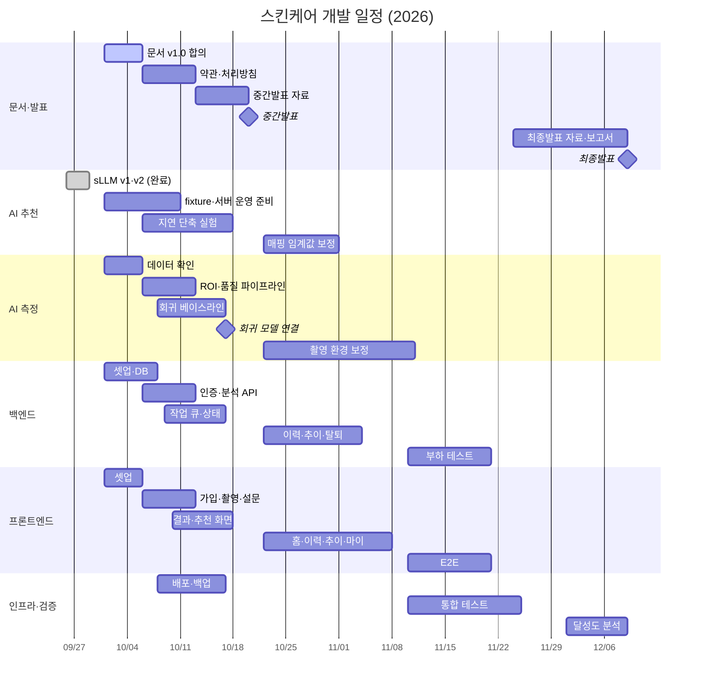

# WBS · 일정

**문서 번호** SC-07 · **버전** v1.0 (2026-10-01) · **작성** 김우주(일정 관리) · **관리** 손승우

상태는 10/1 기준 작성자가 파악한 내용입니다. 첫 주간 회의에서 각자 실제 진행 상태로 고치고, 이후에는 Projects 보드를 기준으로 합니다.

## 1. 주차 기준

| 주차 | 기간 | 학사 일정 |
|---|---|---|
| 5 | 9/29 – 10/5 | **개발 착수** (현재) |
| 6 | 10/6 – 10/12 | 1차 멘토링 (10/6) |
| 7 | 10/13 – 10/19 | 중간발표 준비, 명세 동결 (10/13~) |
| 8 | 10/20 – 10/26 | **중간발표** (10/20 또는 10/21 — 결정 D4) |
| 9–10 | 10/27 – 11/9 | |
| 11 | 11/10 – 11/16 | 2차 멘토링 (11/10) |
| 12–13 | 11/17 – 11/30 | 통합 테스트 |
| 14 | 12/1 – 12/7 | 3차 멘토링 (12/1) |
| 15 | 12/8 – 12/14 | **최종발표 (12/9)** |

## 2. WBS

| ID | 작업 | 담당 | 기간 | 산출물 | 상태 |
|---|---|---|---|---|---|
| **1** | **기획 · 문서** | | | | |
| 1.1 | 개발 문서 v1.0 합의, 결정 D1–D5 확정 | 전원 | 10/1 – 10/5 | 이 문서 묶음 | 진행 |
| 1.2 | 이용약관·개인정보 처리방침 초안 | 손승우 | 10/6 – 10/12 | 약관 문서, 가입 화면 링크 | 예정 |
| 1.3 | 화면 문구·AI 금칙 규칙 검토 | 손승우 | 상시 | `filter_rules.yaml` PR | 예정 |
| 1.4 | 주간보고서 | 손승우 | 매주 | 주간보고서 | 진행 |
| 1.5 | 중간발표 자료 | 김우주 | 10/13 – 10/19 | PPT | 예정 |
| 1.6 | 최종발표 자료 | 김우주 | 11/24 – 12/8 | PPT | 예정 |
| 1.7 | 최종 보고서 | 손승우 | 12/1 – 12/8 | 보고서 | 예정 |
| **2** | **AI — 성분 추천** | | | | |
| 2.1 | sLLM 데이터 준비·QLoRA 학습·평가 (v1, v2) | 김우주 | 9/26 – 9/28 | `rec_sllm_v2`, 비교표 | **완료** |
| 2.2 | 백엔드용 fixture JSON 제공 | 김우주 | 10/1 – 10/3 | `docs/fixtures/*.json` | 예정 |
| 2.3 | 추론 서버 sllm 모드 운영 준비, 고정 터널 | 김우주 | 10/1 – 10/10 | `ai.<도메인>` | 예정 |
| 2.4 | 추천 지연 단축 실험 (출력 길이 제어 등, 목표 p50 30초) | 김우주 | 10/6 – 10/17 | 실험 기록 | 예정 |
| 2.5 | 서빙 매핑 임계값 보정 (회귀 모델 출력 분포 기반) | 김우주 | 10/22 – 10/31 | `serving_mapping.yaml` | 예정 |
| **3** | **AI — 피부 상태 측정** | | | | |
| 3.1 | 피부상태 측정 데이터 수령 확인, 지표 단위·범위 기록 | 박성근 | 10/1 – 10/5 | `docs/metric_scale.md` | 확인 필요 |
| 3.2 | 얼굴 검출·ROI 분할·품질 검사 파이프라인 | 박성근 | 10/6 – 10/12 | 전처리 코드, E2001·E2002 | 예정 |
| 3.3 | 회귀 모델 베이스라인 (피험자 단위 분할) | 박성근, 김우주 | 10/8 – 10/16 | MAE·r 1차 결과 | 예정 |
| 3.4 | 추론 서버에 회귀 모델 연결 (`SKIN_BACKEND=model`) | 김우주 | 10/17 | 데모 배지 제거 | 예정 |
| 3.5 | 촬영 환경 보정 (Gray-World, 기기 임베딩, DANN 비교) | 김우주, 박성근 | 10/22 – 11/10 | 편차 감소율 | 예정 |
| 3.6 | ROI 분할 mIoU 측정 | 박성근 | 11/3 – 11/10 | mIoU | 예정 |
| 3.7 | 피부 타입 지표 (결정 D2에 따름) | 김우주, 박성근 | 10/27 – 11/10 | 분류기 또는 재정의 지표 | 예정 |
| **4** | **백엔드** | | | | |
| 4.1 | NestJS·TypeORM·Docker Compose·CI·Swagger 셋업 | 이현승 | 10/1 – 10/5 | 레포 골격 | 예정 |
| 4.2 | DB 마이그레이션 (DB 설계서 §3) | 이현승 | 10/3 – 10/7 | 마이그레이션 | 예정 |
| 4.3 | 인증 API (가입·로그인·재발급·로그아웃) | 이현승 | 10/6 – 10/10 | `/auth/*` | 예정 |
| 4.4 | AiClient (fixture/real), 분석 생성·조회 | 이현승 | 10/6 – 10/12 | `/analyses` | 예정 |
| 4.5 | 추천 작업 큐 워커 | 이현승 | 10/9 – 10/15 | 워커, 재시도·복구 | 예정 |
| 4.6 | 시스템 상태, 요청 제한 | 이현승 | 10/13 – 10/16 | `/system/status` | 예정 |
| 4.7 | 이력·추이·삭제·탈퇴 API | 이현승 | 10/22 – 11/3 | | 예정 |
| 4.8 | 부하 테스트 (k6) | 이현승 | 11/10 – 11/20 | 부하 테스트 보고 | 예정 |
| **5** | **프론트엔드** | | | | |
| 5.1 | Vite·라우팅·Query·ESLint·CI 셋업 | 정도희 | 10/1 – 10/5 | 레포 골격 | 예정 |
| 5.2 | 로그인·회원가입 | 정도희 | 10/6 – 10/10 | SCR-01, 02 | 예정 |
| 5.3 | 촬영 가이드·촬영·설문·측정 중 | 정도희 | 10/6 – 10/12 | SCR-04 ~ 07 | 예정 |
| 5.4 | 결과 리포트 + 폴링 | 정도희 | 10/10 – 10/17 | SCR-08 | 예정 |
| 5.5 | 추천 상세 | 정도희 | 10/13 – 10/17 | SCR-09 | 예정 |
| 5.6 | 홈·이력·추이·마이 | 정도희 | 10/22 – 11/7 | SCR-03, 10 ~ 12 | 예정 |
| 5.7 | E2E 테스트 (Playwright) | 정도희 | 11/10 – 11/20 | E2E 시나리오 | 예정 |
| **6** | **인프라** | | | | |
| 6.1 | 자택 서버 Docker Compose + Cloudflare Tunnel 배포 | 정도희 | 10/8 – 10/16 | `app.<도메인>` | 예정 |
| 6.2 | DB 백업 자동화 | 정도희 | 10/16 | cron, 7일 보관 | 예정 |
| **7** | **테스트 · 검증** | | | | |
| 7.1 | 3계층 통합 테스트 | 전원 | 11/10 – 11/24 | 테스트 결과서 | 예정 |
| 7.2 | 자체 촬영 테스트셋 수집 (팀원 동의) | 박성근, 정도희 | 11/3 – 11/17 | 테스트셋 | 예정 |
| 7.3 | 성능 목표 달성도 분석 | 김우주, 박성근 | 12/1 – 12/8 | 분석 결과 | 예정 |

## 3. 마일스톤

| ID | 날짜 | 이름 | 완료 기준 |
|---|---|---|---|
| M1 | 10/5 | 착수 | 문서 v1.0 합의, D1–D5 결정, 세 레포 CI·브랜치 보호·Projects 보드 준비 |
| M2 | 10/12 | 골격 | fixture 모드로 가입 → 촬영 → 설문 → 결과 화면까지 로컬에서 동작 |
| M3 | 10/18 | 프로토타입 `v0.1.0` | 배포 서버에서 **실제 AI 서버(sLLM)** 와 연동해 전체 흐름 동작. 회귀 모델 1차 결과 확보 |
| M4 | 10/20~21 | 중간발표 | 시연 + 추천 모델 평가 결과 + 회귀 모델 1차 결과 |
| M5 | 11/10 | 기능 완성 | 도메인 보정, 이력·추이, 피부 타입 지표, mIoU 측정 |
| M6 | 11/24 | 통합 `v0.2.0` | [테스트 계획서](08-test-plan.md) 통합·부하 테스트 통과 |
| M7 | 12/9 | 최종발표 `v1.0.0` | 목표 지표 달성도 분석, 최종 보고서 |

## 4. 일정표

**중간발표까지의 핵심 경로**: 3.2 ROI 파이프라인 → 3.3 회귀 베이스라인 → 3.4 연결(10/17). 이 경로가 밀리면 중간발표는 데모 값 배지를 단 채로 시연하고, 회귀 모델은 오프라인 평가 결과(MAE·r)만 발표합니다.

## 5. 리스크

| ID | 리스크 | 가능성 | 영향 | 대응 | 담당 |
|---|---|---|---|---|---|
| R1 | 회귀 모델이 10/17까지 연결되지 않음 | 중 | 상 | full_face만 먼저 학습하는 단순 베이스라인으로 시작. 미달 시 위 핵심 경로 대안 | 박성근, 김우주 |
| R2 | 학습과 서빙이 같은 GPU를 써서 연동 테스트 시간에 서버가 꺼져 있음 | 상 | 중 | 학습은 야간·주말 배치. 연동 테스트는 하루 전 요청. 10/19–10/21, 12/7–12/9 학습 금지 | 김우주 |
| R3 | 추천 대기 약 50초로 시연이 늘어짐 | 상 | 중 | 측정 결과 선표시(설계 반영), 2.4 지연 단축 실험, 시연은 미리 생성한 분석 1건도 준비 | 김우주, 정도희 |
| R4 | 회귀 모델과 sLLM을 함께 올리면 VRAM 부족 | 하 | 중 | 회귀 모델 FP16/ONNX, 연결 시 VRAM 측정 | 김우주 |
| R5 | 임시 터널 주소가 바뀌어 연동이 끊김 | 중 | 중 | 결정 D3 (도메인 + named tunnel) | 김우주, 정도희 |
| R6 | 피부 타입 85% 목표의 측정 방법이 없음 | 상 | 중 | 결정 D2 | 김우주, 손승우 |
| R7 | 공개 레포에 데이터·비밀값 커밋 | 하 | 상 | `.gitignore`, secret scanning, PR 리뷰 체크 | 전원 |
| R8 | 중간고사 기간과 일정 겹침 | 중 | 중 | M3(10/18)를 중간발표 직전 버퍼로 둠. 개인 일정은 첫 회의에서 공유 | 김우주 |
